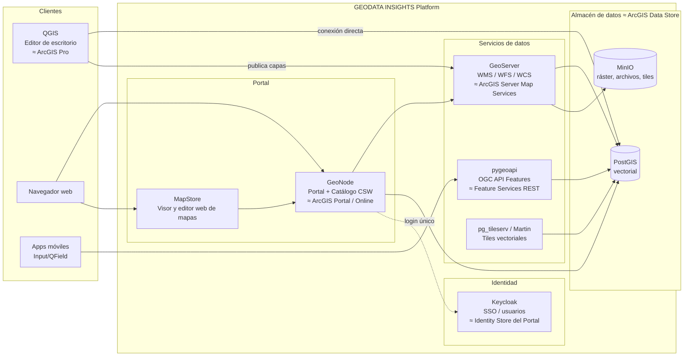

# GEODATA INSIGHTS Platform — Arquitectura

> Plataforma geoespacial empresarial 100% open-source, equivalente funcional de **ArcGIS Enterprise**.

## 1. Visión general

El sistema replica el flujo completo de ArcGIS Enterprise:

```
Captura/Edición (QGIS) → Almacén (PostGIS + MinIO) → Servicios OGC/REST (GeoServer + pygeoapi)
→ Portal/Catálogo (GeoNode) → Apps web (MapStore + apps custom)
```



## 2. Mapa de equivalencias (ArcGIS Enterprise → GEODATA INSIGHTS)

| Componente Esri | Nuestro equivalente | Función | Estado |
|---|---|---|---|
| ArcGIS Pro | **QGIS** | Edición, análisis y diseño de mapas en escritorio | Listo para usar |
| ArcGIS Server (Map/Image/Feature Services) | **GeoServer** | Servicios OGC: WMS, WFS, WCS, WMTS | ✅ En compose |
| ArcGIS Server (REST API moderna) | **pygeoapi** | OGC API Features, procesos | Fase 3 |
| Vector Tile Services | **pg_tileserv / Martin** | Tiles vectoriales desde PostGIS | Fase 3 |
| ArcGIS Portal | **GeoNode** | Portal web: capas, mapas, usuarios, grupos, permisos, galería | ✅ En `portal/` |
| ArcGIS Online (visor/app builder) | **MapStore** (integrado en GeoNode) | Crear mapas web, dashboards y geostories sin código | ✅ Con GeoNode |
| ArcGIS Data Store | **PostGIS** + **MinIO** | Vectorial + objetos (ráster, adjuntos, tiles) | PostGIS ✅ / MinIO fase 3 |
| Identity Store / SAML | **Keycloak** | SSO centralizado para portal, GeoServer y apps | Fase 4 |
| Network Analyst | **pgRouting / Valhalla** | Ruteo y análisis de redes | Fase 4 |
| Geocodificador | **Nominatim / Photon** | Geocodificación propia | Fase 4 |
| ArcGIS Hub / StoryMaps | **MapStore GeoStories** / apps custom | Portales de datos abiertos y narrativas | ✅ Parcial con MapStore |
| Field Maps | **QField / Input (Mergin Maps)** | Captura en campo sincronizada con PostGIS | Fase 4 |

## 3. Estructura del repositorio

```
geodata-platform/
├── docker-compose.yml        # Núcleo: PostGIS + GeoServer
├── .env.example              # Plantilla de configuración (copiar a .env)
├── docs/
│   └── ARCHITECTURE.md       # Este documento
├── scripts/
│   └── db/                   # Scripts SQL de inicialización (initdb)
├── geoserver_data/           # Data dir de GeoServer (workspaces, estilos)
└── portal/
    └── geonode-project/      # GeoNode personalizado (marca GEODATA INSIGHTS)
```

## 4. Puertos asignados

| Servicio | Puerto host | URL |
|---|---|---|
| PostGIS (núcleo) | 5434 | `localhost:5434` |
| GeoServer (núcleo) | 8085 | http://localhost:8085/geoserver |
| GeoNode (portal) | 8084 | http://localhost:8084 |
| GeoServer de GeoNode | — | http://localhost:8084/geoserver (vía proxy del portal) |
| Keycloak (fase 4) | 8086 | http://localhost:8086 |

> Puertos 5432/5433/8080-8083 evitados por conflicto con otros proyectos locales (SIATA, huella, CVAT/traefik). Cambiables en `.env`.

> **Nota:** GeoNode levanta su propio stack completo (Django + GeoServer + PostGIS interno + Celery + RabbitMQ). Es deliberado: el portal gestiona sus metadatos ahí; los **datos geográficos de negocio** viven en el PostGIS del núcleo y se registran en GeoNode como almacenes remotos.

## 5. Flujo de trabajo objetivo (el "flujo ArcGIS" traducido)

1. **Diseñar/cargar datos** en QGIS → guardar en **PostGIS** (conexión `geodata_db`).
2. **Publicar** la capa en **GeoServer** desde QGIS (plugin *GeoServer Explorer* / *Geocat Bridge*) o vía API REST de GeoServer.
3. **Registrar/cosechar** la capa en **GeoNode**: automático, ya que GeoNode hereda las capas de su GeoServer; para el GeoServer del núcleo se usa el servicio de *harvesting* (WMS/WFS remoto).
4. **Catalogar**: completar metadatos (ISO 19115), asignar permisos por grupo, agregar thumbnail.
5. **Crear mapa web** en MapStore combinando capas → queda disponible en la galería del portal (como los *Web Maps* de ArcGIS Online).
6. **Consumir** desde apps: Leaflet/OpenLayers (WMS/WFS), pygeoapi (JSON/REST), o tiles vectoriales.

## 6. Decisiones arquitectónicas clave

- **Monorepo** con docker-compose por fases; migración futura a Kubernetes (GeoNode publica Helm charts).
- **Datos de negocio separados del portal**: el portal es reemplazable; PostGIS es la fuente de verdad.
- **Marca blanca**: `geonode-project` permite tema, logo y nombre propios (GEODATA INSIGHTS) — clave para venderlo como producto.
- **Rendimiento**: caché de tiles con **GeoWebCache** (incluido en GeoServer) y tiles vectoriales Martin para datasets grandes.
- **Seguridad**: `.env` nunca versionado; HTTPS con Caddy/Traefik en producción; Keycloak para SSO.

## 7. Roadmap

| Fase | Alcance | Entregable |
|---|---|---|
| **1. Núcleo** | PostGIS + GeoServer + persistencia + QGIS conectado | Infraestructura de datos y servicios OGC |
| **2. Portal** | GeoNode con branding GEODATA INSIGHTS | Portal web operativo (el "ArcGIS Online" propio) |
| **3. Servicios modernos** | pygeoapi, Martin, MinIO | APIs REST/tiles tipo Feature Services y VTS |
| **4. Empresarial** | Keycloak SSO, pgRouting, Nominatim, monitoreo, K8s | Producto vendible con SLA |

—
*GEODATA INSIGHTS · Arquitectura v1.0*
